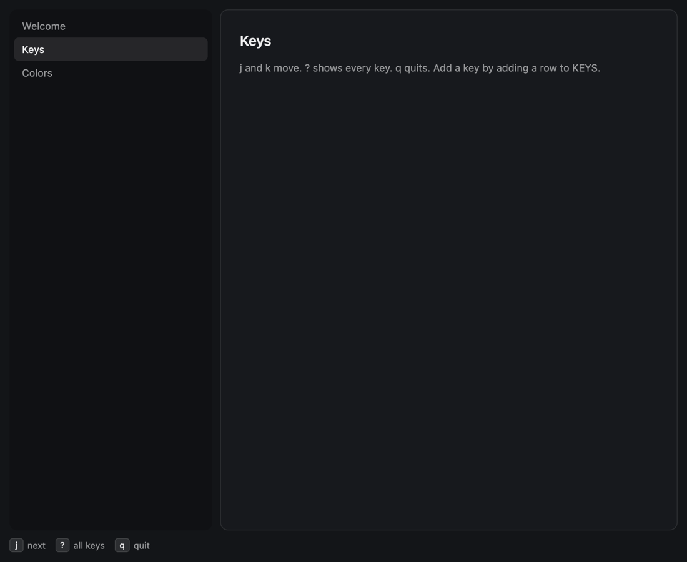
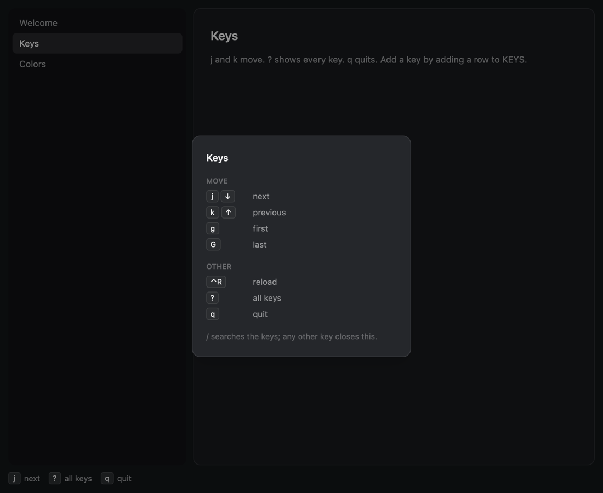

# bmo

Ask a coding agent for a desktop app in one sentence, and get a native macOS app back.

bmo is the host that makes that work. It is one program: the command line the agent drives, and the runtime the apps run on. The agent writes a folder of JavaScript, bmo draws it with [GPUI](https://www.gpui.rs), and the result opens in its own window, under its own app id, driven by the keyboard.



> **Status:** an experiment in daily use by its author. macOS only. Expect things to change.

## Why

Agents write good code when the platform is small, opinionated and checkable. bmo is built around that:

- **Building blocks, not a framework.** Apps draw with layout elements and reach the outside through one `bmo` module: colors, programs, HTTP, sockets, files and [Herdr](https://herdr.dev) agent sessions.
- **A loop the agent closes alone.** `bmo check` reports errors and `bmo shot` saves a screenshot of a hidden copy, pressing keys first if asked. No window opens on your desktop while the agent works.
- **Conventions built in.** Every new app starts with vim keys, a footer of key hints, a searchable help popup and one look for light and dark.
- **No permissions to manage.** Apps are trusted, as scripts on your own machine are.
- **Changes land in place.** `bmo reload` checks an app and hands the new code to its open window, without closing it.

## Install

bmo needs Rust and macOS. It builds against a [fork of gpui-kit](https://github.com/juanibiapina/gpui-kit) that carries a few fixes not yet upstream, checked out beside it:

```sh
git clone https://github.com/juanibiapina/gpui-kit
git -C gpui-kit checkout shell-reload-on-demand
git clone https://github.com/juanibiapina/bmo
cargo install --path bmo --locked
```

## Use

Ask your agent:

> build me a Hacker News reader app

Any bmo command writes a skill to `~/.agents/skills/bmo/SKILL.md`, where coding agents look for skills, so the agent finds bmo by itself and the skill always matches the installed version. The skill sends the agent to `bmo guide`, the full manual: the build loop, the drawing vocabulary, the `bmo` module and the conventions.

Then keep talking to the agent: "install it", "make the list wider", "show who reacted when I select a reaction". Apps live in `~/.config/bmo/apps/<name>/`, and an installed app appears in `~/Applications` with the id `bmo.<name>`.

## Commands

| Command | What it does |
|---|---|
| `bmo guide` | Prints the manual an agent reads first |
| `bmo new <name>` | Creates an app from a working starting point |
| `bmo check <name>` | Loads the app and draws it once, with no window |
| `bmo shot <name>` | Saves a screenshot of a hidden copy; `--keys "j j ?"` presses keys first, `--wait 5` gives slow work time |
| `bmo dev <name>` | Opens the app in a window that reloads on save; `bmo stop <name>` closes it |
| `bmo run <name>` | Runs the app in a window until it closes |
| `bmo install <name>` | Installs the app in `~/Applications` |
| `bmo reload <name>` | Checks the app, then gives its open window the new code |
| `bmo list` | Lists the apps and which are installed |

`BMO_HOME` picks another home than `~/.config/bmo`, and `BMO_SKILLS` another skills folder.

## What an app looks like

One class with a `render` method, and one table that says what every key does. The footer and the help popup are drawn from that table.

```js
import { View, div } from "gpui-kit";
import { v_flex } from "gpui-base";
import { theme, fetch } from "bmo";

export default class App extends View {
  init(_props, cx) {
    this.stories = [];
    cx.spawn(async (cx) => {
      const response = await fetch("https://hacker-news.firebaseio.com/v0/topstories.json");
      this.stories = JSON.parse(response.body).slice(0, 30);
      cx.notify();
    });
  }

  render() {
    const t = theme();
    return v_flex().size_full().p(12).bg(t.canvas).text_color(t.foreground)
      .children(this.stories.map((id) => div().child(String(id))));
  }
}
```



## How it is tested

- **Tests** run the built `bmo` against a temporary home and check what an app can do by taking a screenshot of it. `just test` runs them; `just test-desktop` adds the ones that open a window.
- **Trials** test the whole experience. A fresh agent session gets a request in a user's words and builds the app alone; the app and the session are then reviewed, bmo is changed, and the trial runs again. Nobody edits the app by hand: what the agent lacks is a gap in bmo. The requests and the run logs are in [trials/](trials/README.md).

## Built on

[gpui-shell](https://gpui-kit.com/shell/) from GPUI Kit runs the JavaScript and draws it with GPUI. bmo's look is [Herdr](https://herdr.dev)'s graphite and paper palettes.

## License

[Apache-2.0](LICENSE)
